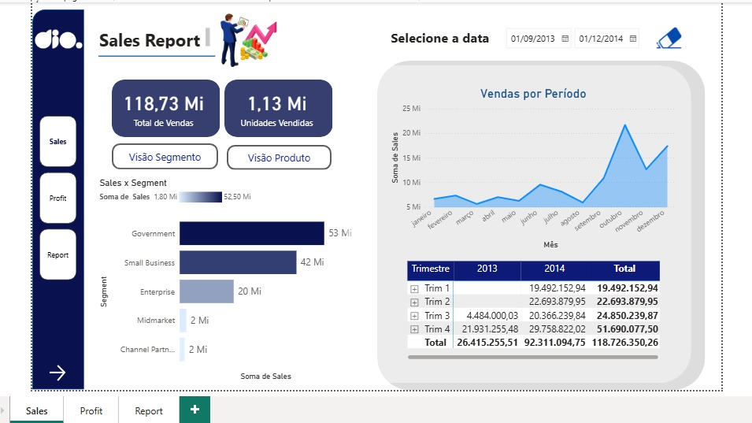
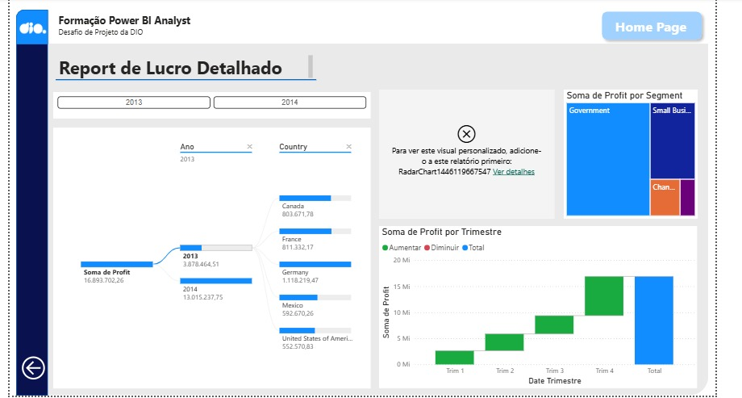
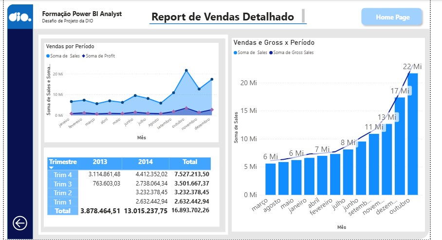

# Desafio DIO: Projeto de Data Analytics com Power BI

Projeto prático do desafio da DIO. Parti do relatório criativo fornecido no curso (3 páginas: **Sales**, **Profit** e **Report**) e o analisei pensando na experiência do usuário.

## 🖼️ Prévia

### Sales

### Profit

### Report

## 📄 Páginas do relatório

| Página | O que mostra |
|---|---|
| **Sales** | Indicadores (total de vendas e unidades vendidas), vendas por segmento ou por produto, vendas por período e tabela por trimestre, com filtro de datas |
| **Profit** | Árvore de decomposição, gráfico de cascata, radar, treemap e filtro por botões |
| **Report** | Gráfico de colunas e linha, gráfico de área e tabela dinâmica |

## 🎯 Pontos de experiência do usuário analisados

| Ponto | O que observei no relatório |
|---|---|
| **Navegação** | Menu lateral com botões para as 3 páginas. O botão da página atual fica destacado e o botão muda ao passar o mouse |
| **Segmentação** | Filtro de datas e botões "Visão Segmento" / "Visão Produto" que alternam o gráfico |
| **Posicionamento** | Indicadores no alto da página e gráfico de área em destaque à direita |
| **Contraste** | Textos pequenos e claros nos botões e eixos eram difíceis de ler |

## 🔧 Alteração feita

- **Contraste nos botões "Visão Segmento" e "Visão Produto":** deixei o texto em azul escuro e com tamanho maior, para ficar legível sobre o fundo claro.

## 📁 Conteúdo do repositório

- `desafio-7-power-bi.pbix`: projeto do Power BI
- `pagina-sales.jpeg`, `pagina-profit.jpeg`, `pagina-report.jpeg`: prints das páginas
- `README.md`: este arquivo

## ▶️ Como abrir

1. Instale o **Power BI Desktop** (gratuito, só para Windows).
2. Baixe o arquivo `desafio-7-power-bi.pbix`.
3. Abra no Power BI Desktop.
4. Para testar os botões, segure **Ctrl** e clique neles.

## 🧠 O que aprendi

Aprendi a analisar um relatório do ponto de vista de quem vai usá-lo, observando navegação, segmentação, posicionamento e contraste. Na prática, melhorei a legibilidade dos botões de visão, deixando o texto maior e mais escuro.

## 🔗 Referências

- Repositório do curso: https://github.com/julianazanelatto/power_bi_analyst
